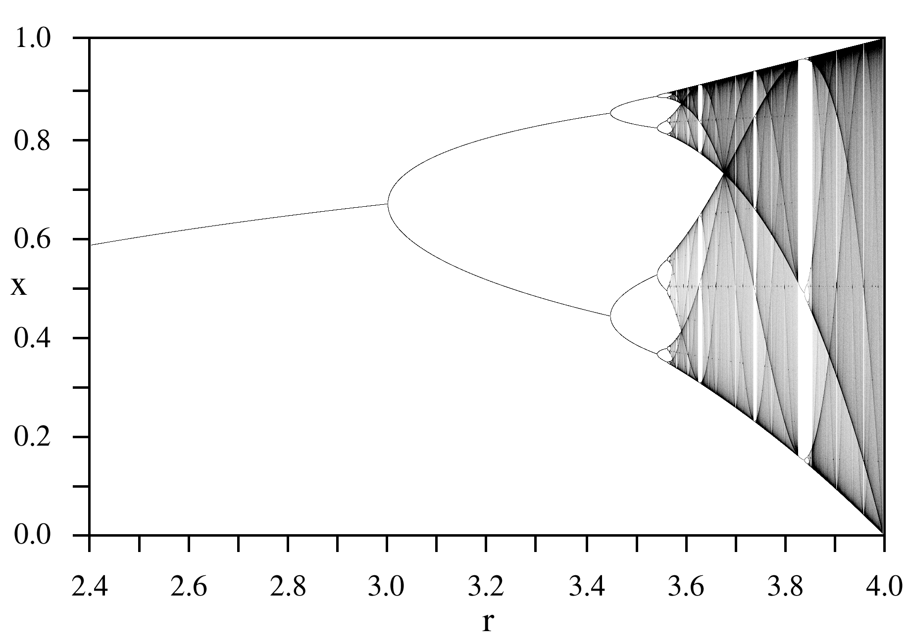
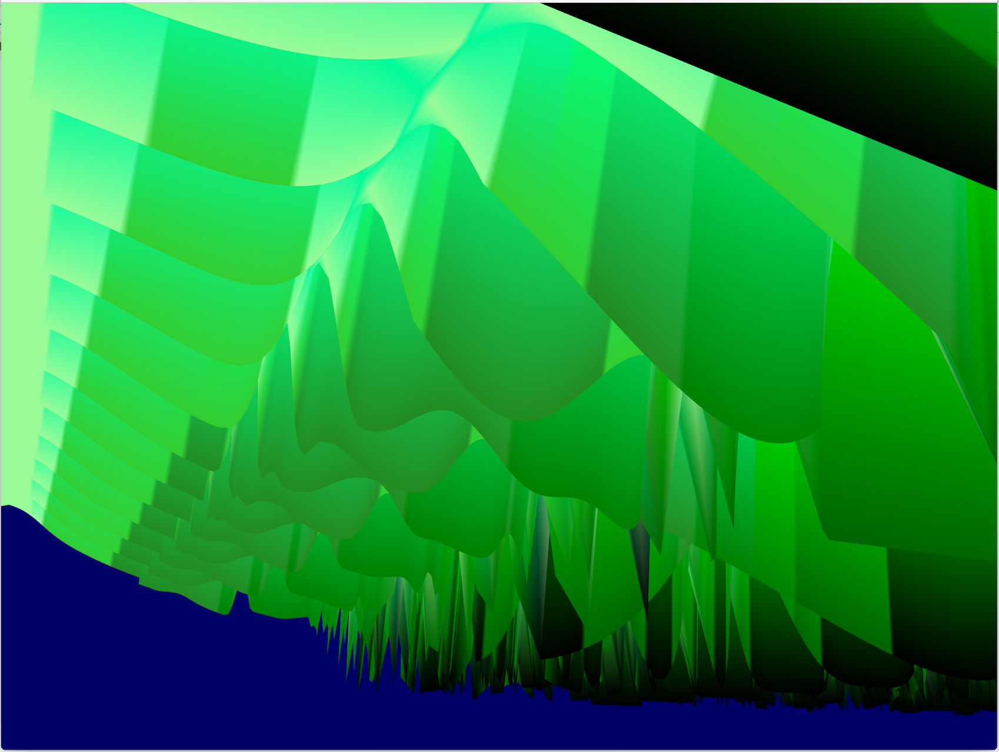
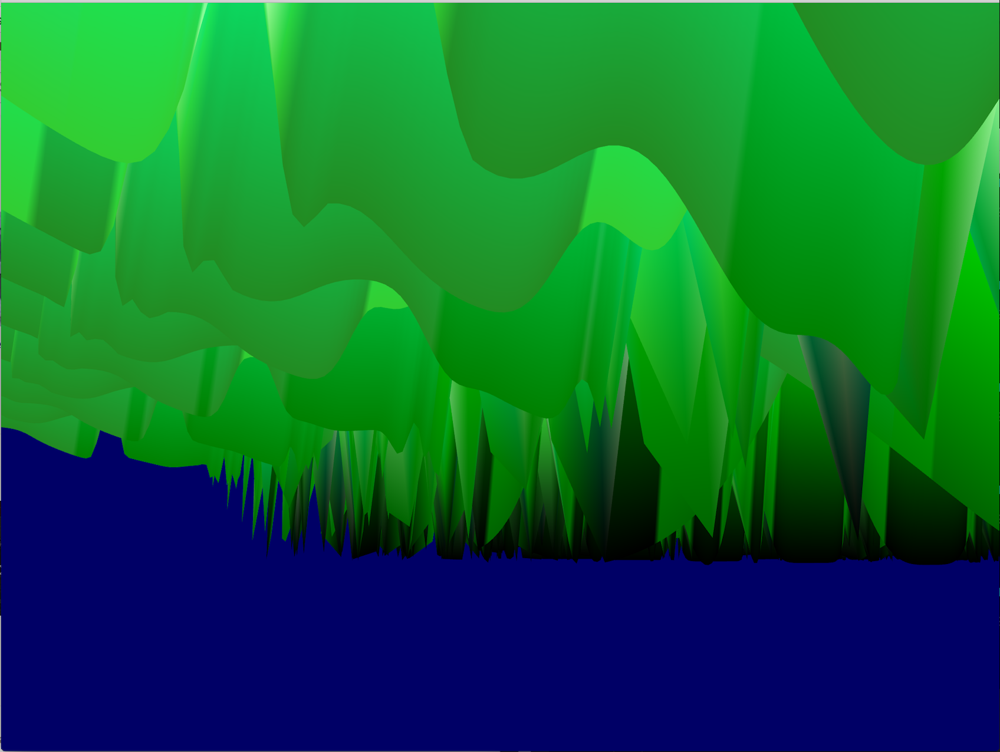
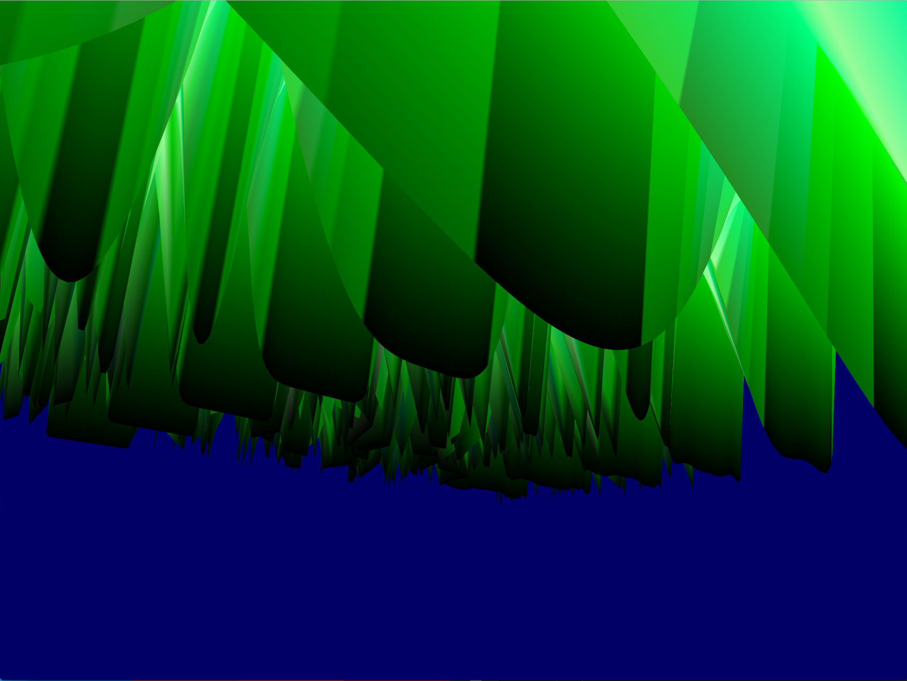
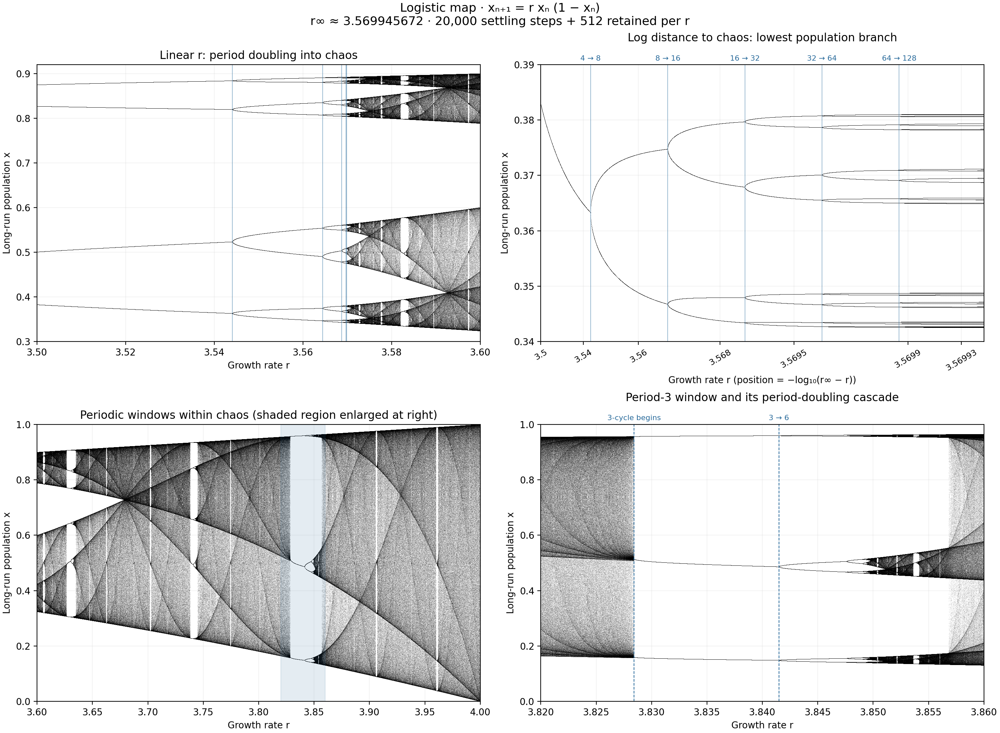

# Modeling Chaos in OpenGL

## Motivation
#### Logistic Map


This is the equation of the logistic map. x<sub>n+1</sub> where n is a step in a time unit. The value of x<sub>n+1</sub> can be found by multiplying the growth rate r with the current population and 1 minus the current population.

This equation can represent a nice simplified behavior in the change of population. Let's take the population of wolves for example. The current population of wolves will grow by a certain growth rate within a given amount of time. The more wolves there are the faster the population multiplies. The population will grow until there are too many wolves and not enough space, food, etc to support them all. At this point the population will decrease, this behavior is captured in the multiplication of 1 - x<sub>n</sub>.

#### Bifurcation Diagram


At growth rate 2.8 the population settles to a single value. At 3.2 the population alternate between two different values. At 3.5 there is another split and the function alternates between 4 values. This division happens until chaos occurs. The grey spaces are where no pattern is found. The system eventually stabilizes. This can be seen in the white spaces in between blocks of chaos. The system alternates between fixed number of values until chaos hits again.

## Modelling this Diagram in 3D

I think it would be cool to model this diagram in three dimensions; x value being time, y being the population and z being the growth rate.





The beginning of the model shows nice waves, representing the system settling to a fix number of values. These waves are followed by chaotic spikes. In the last picture, we see the system once again settling only to be followed by chaos once again.

## Running the Code

```
>> g++ -std=c++11 common/shader.cpp common/controls.cpp chaos.cpp -framework OpenGL -framework Cocoa -framework IOKit -framework CoreVideo -lglfw3 -lglew

>> ./a.out
```

## Generating the Bifurcation Zooms



From the repository root, with Python 3, NumPy and Matplotlib installed:

```bash
python scripts/bifurcation.py
```

This saves `graphs/bifurcation_zooms.png` without opening a window. The four panels show:

- **Linear r, 3.5–3.6:** the period-doubling sequence and the onset of chaos.
- **Logarithmic distance to chaos:** horizontal position is
  `−log10(r∞ − r)`, where `r∞ ≈ 3.569945672`. Tick labels show actual r values.
  This panel approaches the accumulation point **from below**, stopping at a
  distance of `0.00001`; it does not include the chaotic region above it.
  The population axis zooms to 0.34–0.39 to isolate the lowest branch.
  Blue lines label the periods immediately before and after each split.
- **Chaotic-region overview, r = 3.6–4.0:** sparse repeating branches interrupt
  the dense chaotic regions, leaving large white windows. The shaded interval
  is enlarged in the next panel.
- **Period-3 window, r = 3.82–3.86:** a stable three-population cycle appears at
  `r = 1 + √8 ≈ 3.828427`, then splits into six, twelve, and more populations
  before returning to chaos. Dashed lines mark the onset and first doubling.
  These windows are returns to periodic behavior, not simply branches merging;
  blank space elsewhere can also be gaps between chaotic bands.

Unlike simply using `log(r)`, the distance transform spreads out successive
splits. Each panel samples 6,000 r values uniformly in its displayed horizontal
coordinate, discards 20,000 settling steps per r, and retains the next 512 values.
These are finite numerical approximations: convergence slows near a split, and
fine branches eventually require further population-axis zooming as well.
The OpenGL visualization is unchanged.

Sampling and output can be overridden, for example:

```bash
python scripts/bifurcation.py --samples 10000 --burn-in 40000 --iterations 1024 --output graphs/bifurcation_detailed.png
```

## Thank You and Further Reading

The majority of the code found in the common folder was learned from a great OpenGL tutorial. To learn more about OpenGL follow the link to this tutorial.

http://www.opengl-tutorial.org/