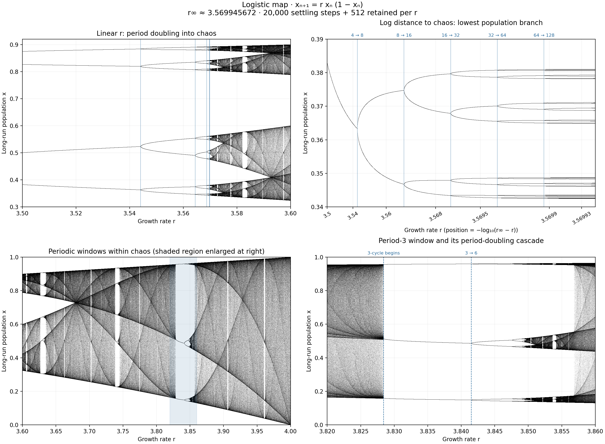

# Session 2026-11-22 — Bifurcation diagrams

## State

The original README and OpenGL visualization are preserved. These new views
explore the logistic map, `xₙ₊₁ = r xₙ (1 − xₙ)`:



| Panel | View |
| --- | --- |
| Top left | Linear r = 3.5–3.6: period doubling into chaos. |
| Top right | Log distance to chaos, zoomed onto the lowest population branch. Blue lines mark splits. |
| Bottom left | r = 3.6–4.0: periodic windows within chaos; shading locates the detail at right. |
| Bottom right | r = 3.82–3.86: the three-cycle window, its splits, and return to broad chaos. |

## Findings

- **The horizontal axis is not time.** Each vertical slice is an independent
  simulation at a chosen r. Its dots are successive long-run populations,
  not separate paths travelling sideways.
- **How experiments start:** every r starts from `x₀ = 0.123456789`, an arbitrary
  initial population. We discard 20,000 settling steps and plot the next 512.
  Each panel samples 6,000 r values.
- **“3-cycle begins” means stability emerges from chaos.** Just above
  `r = 1 + √8 ≈ 3.828427`, the population settles into `A → B → C → A → …`.
  Other values stop being visited long-term; they do not merge into three paths.
  Stable means small disturbances decay back toward the cycle, not a constant
  population. Large white windows surround sparse periodic branches; other
  blank regions can simply be gaps between chaotic bands.
- **Why grey suddenly fills the gaps near r ≈ 3.8568:** after the sequence
  `3 → 6 → 12 → …`, chaos initially occupies three narrow bands. An *interior
  crisis* involving an unstable three-cycle abruptly expands the accessible
  range. The new grey represents excursions into that range, not new experiments.
- **A four-cycle is not the next numbered stage.** The original four-cycle starts
  at `r = 1 + √6 ≈ 3.44949`. A separate four-cycle window appears near `3.9601`.
  Each window has its own doubling sequence, such as `4 → 8 → 16 → …`.

## Decisions

Use `−log10(r∞ − r)`, with `r∞ ≈ 3.569945672`, rather than `log(r)`:
this expands the shrinking intervals between splits. Tick labels still show r.
The log view approaches from below, stopping at distance `0.00001`, with
population restricted to 0.34–0.39. Finite settling time and image resolution
limit detail near bifurcations.

## Changes

- `docs/graphs/bifurcation_zooms.png` holds the four-panel figure.
- `scripts/bifurcation.py` regenerates it headlessly; the test script was removed.

From the repository root, with Python 3, NumPy and Matplotlib installed:

```bash
python scripts/bifurcation.py
# Optional higher sampling; writes to the same default path:
python scripts/bifurcation.py --samples 10000 --burn-in 40000 --iterations 1024
```

Use `--output <path>` to save elsewhere.
