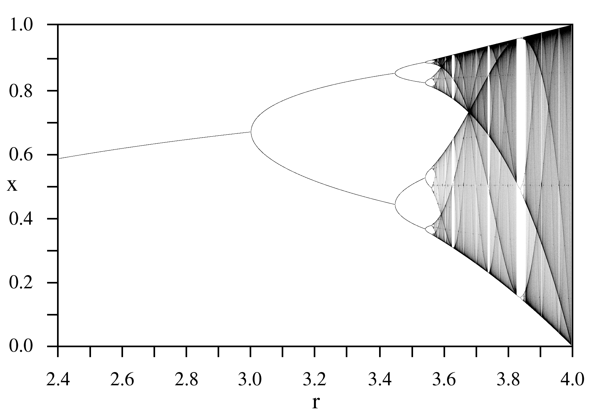
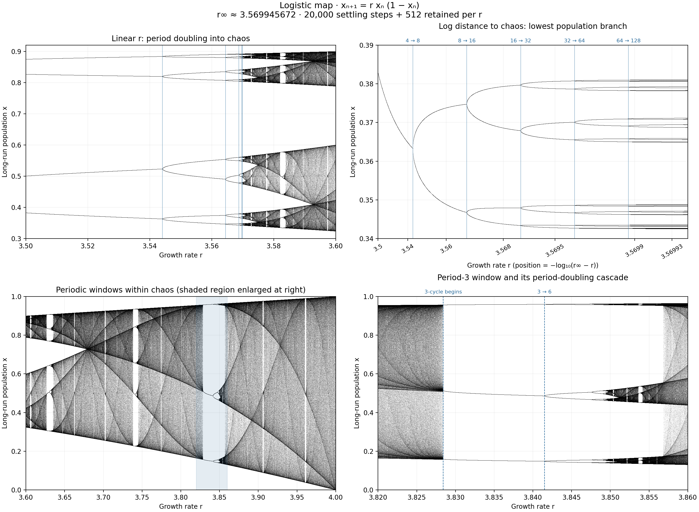
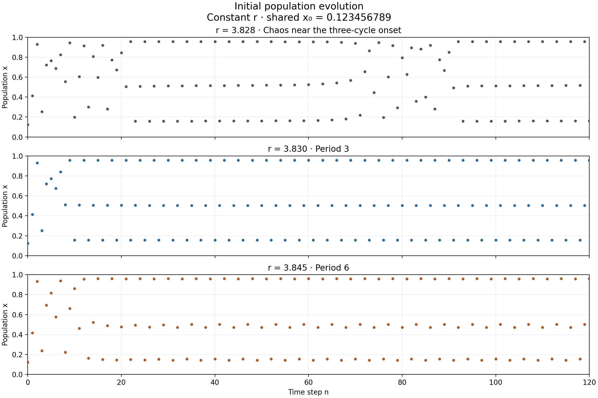
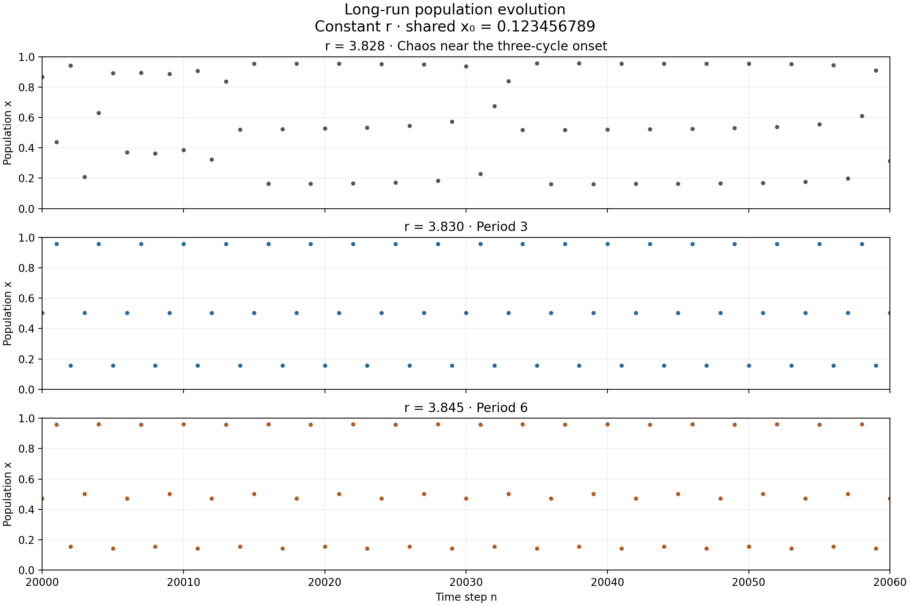
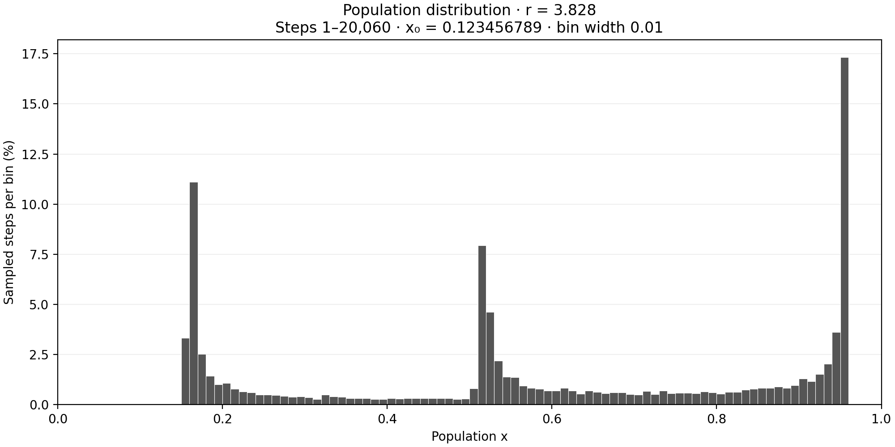
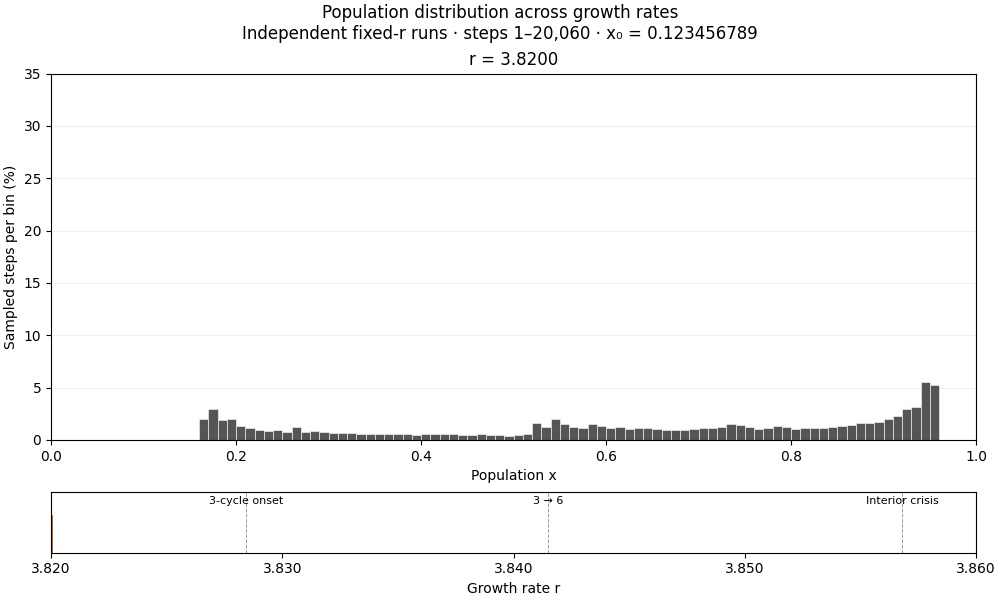
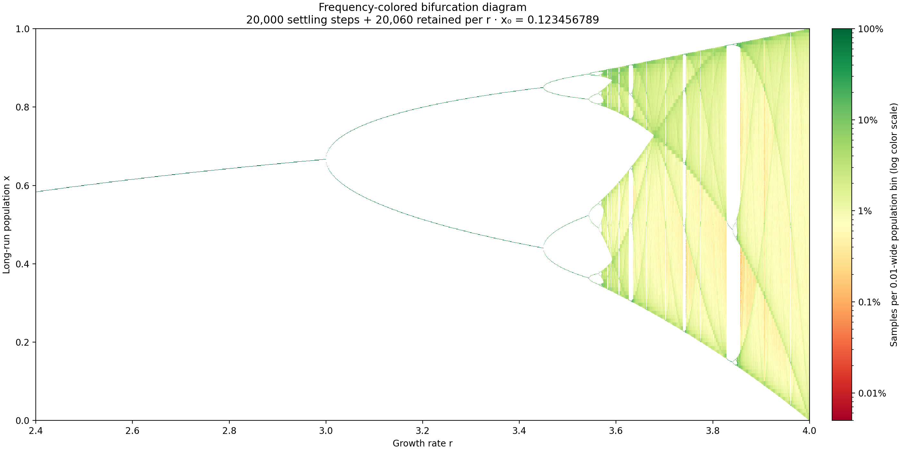

# Logistic-map dynamics

The logistic map evolves population x at growth rate r:

`xₙ₊₁ = r xₙ (1 − xₙ)`

## Bifurcation diagram



Each vertical slice shows the long-run populations at one constant growth rate.
Increasing r reveals fixed populations, repeating cycles, and chaotic regions
interspersed with periodic windows.

## Detailed views



- **Top left:** r = 3.5–3.6 resolves the `4 → 8 → 16 → …` sequence into chaos.
- **Top right:** `−log10(r∞ − r)`, with `r∞ ≈ 3.569945672`, expands the shrinking
  intervals between splits. Tick labels show r; the population axis isolates
  the lowest branch.
- **Bottom left:** r = 3.6–4.0 reveals periodic windows within chaos. The shaded
  interval is enlarged at right.
- **Bottom right:** a stable three-cycle emerges at `r ≈ 3.828427`, then doubles
  through `3 → 6 → 12 → …`. Near `r ≈ 3.8568`, an interior crisis abruptly
  expands the chaotic population range, filling the large gaps with grey.

These views sample 6,000 growth rates per panel, discard 20,000 settling steps,
and retain the next 512 populations at each rate.

## Population over time

Each dot shows the population at an integer time step. Three independent runs
share `x₀ = 0.123456789`, each with a constant growth rate:

| r | Long-run behavior |
| --- | --- |
| 3.828 | Chaos just below the three-cycle onset |
| 3.830 | A repeating three-population cycle |
| 3.845 | A repeating six-population cycle |



**Initial evolution, steps 0–120.** The shared starting population develops into
irregular fluctuations or approaches a repeating rhythm, depending on r.



**Long-run detail, steps 20,000–20,060.** At r = 3.828, near-three-step rhythms
are interrupted by irregular bursts. At 3.830, three values repeat; at 3.845,
six values repeat as two alternating triplets. Stable cycles draw nearby
populations toward the same repeating orbit.

## Population distribution at r = 3.828



Each bar gives the percentage of steps whose population falls within a
0.01-wide interval. The sample covers steps 1–20,060 from `x₀ = 0.123456789`,
including initial settling. Peaks show frequently visited population ranges;
the spread between them captures the irregular excursions.

## Distribution across growth rates



The animation advances r by 0.0002 per frame. Each frame samples an independent
constant-r run over steps 1–20,060 from the same initial population, using
0.01-wide bins and fixed axes. The sweep reveals the three-cycle window,
its period-doubling sequence, and the broader distribution after the interior
crisis. The lower cursor locates each frame within the growth-rate range.

## Reproduce

From the repository root, using Python 3 with NumPy, Matplotlib, and Pillow:

```bash
python scripts/bifurcation.py
python scripts/population_time.py
python scripts/population_distribution.py
python scripts/distribution_animation.py
python scripts/bifurcation_frequency.py
```

Generated figures are saved in `docs/graphs/`.

## Frequency-colored bifurcation diagram



The original r = 2.4–4.0 view is regenerated with color showing the percentage
of retained steps in each 0.01-wide population bin. Warm red/orange marks lower
frequencies, yellow marks the transition, and green deepens toward higher
frequencies. White marks unsampled ranges. A logarithmic color scale brings out
both concentrated periodic cycles and spread-out chaotic populations. Branch
positions use finer 0.001-wide bins.

Each of 4,000 constant-r runs starts at `x₀ = 0.123456789`, discards 20,000
settling steps, and retains 20,060 steps for the frequency estimate.
